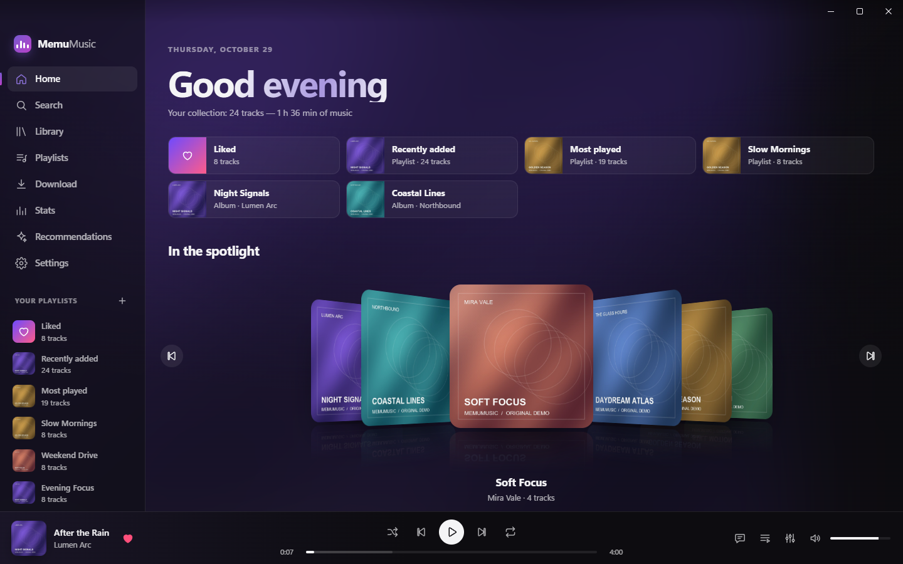
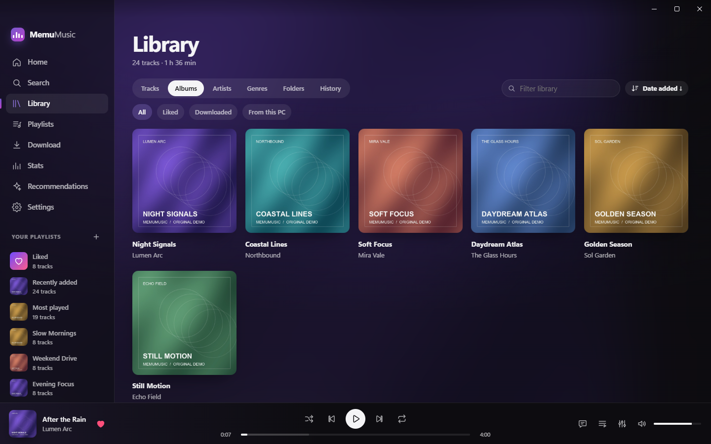
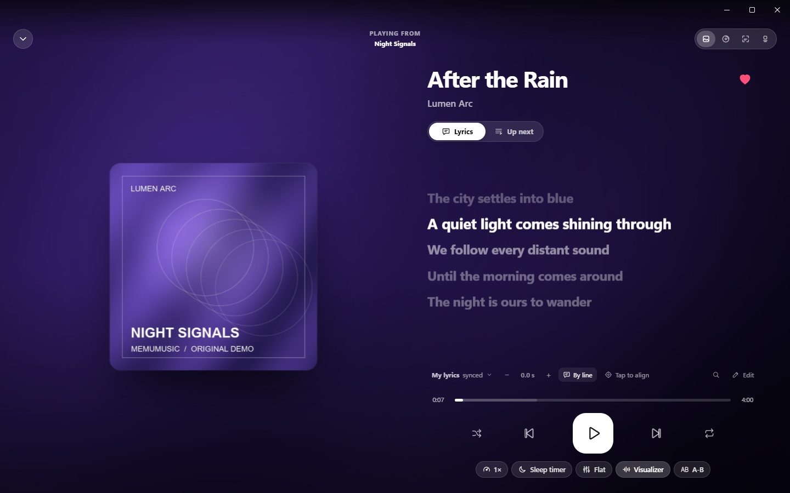
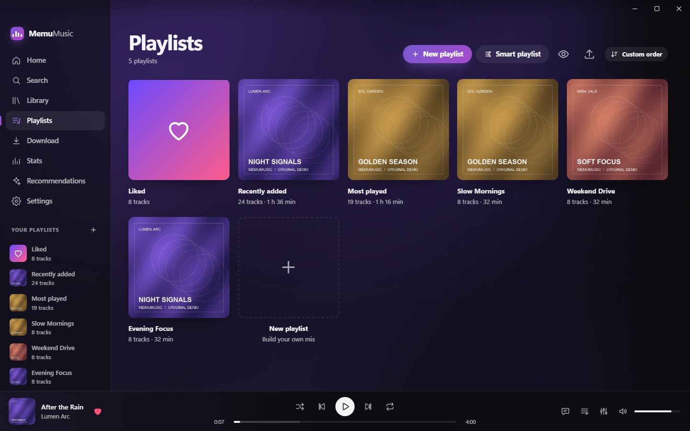
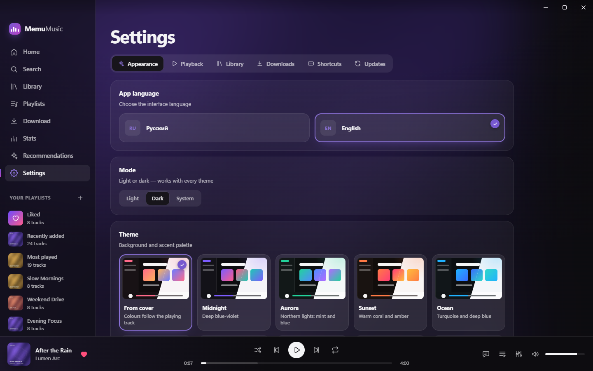

# MemuMusic

[Русский](README.md) · **English**

A lightweight, beautiful and convenient music player for Windows with a wide range of features.

## Features

- Download tracks from YouTube, SoundCloud and many other services, or add tracks you already have.
- Create your own playlists, or use Smart Playlists for whatever you need.
- Find tracks directly in the app with Search.
- Now Playing: a beautiful full-screen view with synchronized lyrics in real time, plenty of settings and more.
- Make it your own: choose from many themes, quality settings and more.
- Create your own collections of tracks and artists.
- Recommendations: get suggestions based on your tracks and data from YouTube Music.
- And much more, with even more to come in the future!

## Screenshots

## Important!

- The project was made using AI. Whether or not to use it is entirely up to you, but the use of AI is not hidden — so there is no license, take what you want!
- MemuMusic is based on [MemuAI](https://github.com/MemuAI/MemuAI), one of the largest applications for chatting and working with AI, where MemuMusic is an optional built-in module. You can use MemuMusic as a module in MemuAI: it has even more functionality, including AI recommendations and AI-powered lyrics search. The applications are otherwise practically identical, but the choice is entirely yours.
- There is plenty of potential to add many more features in the future, but I cannot promise whether or not they will be added.

Project license: Unlicense. Retained copyright notices and dependency licenses are listed in `licenses/` and `THIRD_PARTY_NOTICES.md`.
